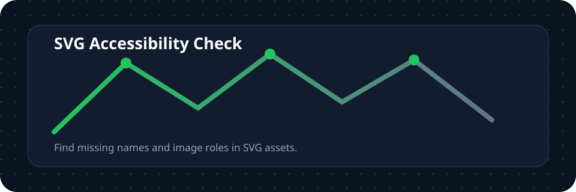

<div align="center">


[](LICENSE)



</div>

## :compass: Overview

A dependency-free Python checker for local SVG files. It looks for missing accessible names and image roles, while respecting intentionally decorative SVGs marked aria-hidden.

## :sparkles: Features

- :white_check_mark: Scans individual SVG files or whole directories
- :white_check_mark: Checks title or aria-label and role=img semantics
- :white_check_mark: Ignores intentionally decorative aria-hidden SVGs
- :white_check_mark: Reports malformed XML and exits non-zero on issues

## :clapper: Demo

```bash
python main.py examples --recursive
```

The example runs locally; no hosted service or upload is required.

## :rocket: Quick Start

```bash
python -m pip install -r requirements.txt
python main.py examples --recursive
```

Run `python main.py --help` to see all supported options.

## :toolbox: Tech Stack

- Python 3.10+ standard library (ElementTree)
- Automated tests: unittest
- Local-first processing

## :file_folder: Folder Structure

```text
svg-a11y-check/
├── main.py
├── requirements.txt
├── tests/test_core.py
├── examples/sample.svg
└── assets/illustration.svg
```

## :world_map: Roadmap

- [x] Core workflow and CLI
- [x] Example input and tests
- [ ] Additional report formats
- [ ] Continuous integration on supported platforms

## :handshake: Contributing

Issues and pull requests are welcome. Keep changes focused, document behavior changes, and add tests for new features.

## :page_facing_up: License

MIT - see [LICENSE](LICENSE).

<div align="center"></div>
